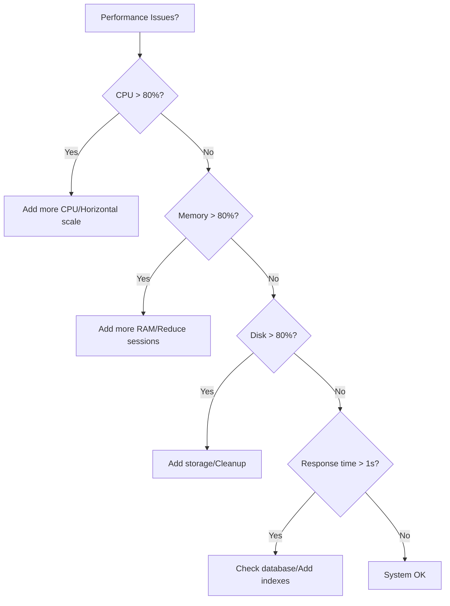

# 11 - Operational Runbooks

## 11.1 Overview

This document contains Standard Operating Procedures (SOP) for OpenWA operations, including incident response, maintenance procedures, and troubleshooting guides.

### Runbook Structure

Each runbook follows this format:

```
## Runbook: [Title]
### Trigger
### Impact
### Prerequisites
### Steps
### Verification
### Rollback
```

## 11.2 Incident Response

### Runbook: Service Down

**Trigger:** Health check failing, API not responding

**Impact:** All sessions affected, messages not processing

**Prerequisites:**

- SSH access to server
- Docker CLI access
- Database access
- An OPERATOR (or ADMIN) API key, to start sessions and send the test message

**Steps:**

```bash
# 1. Check container status
docker compose ps

# 2. Check container logs. Every `docker compose … openwa-api` below names the service as the
#    production docker-compose.yml defines it — on docker-compose.dev.yml that service is called
#    `openwa`, so substitute it there. The bare `docker stats`/`docker restart` forms take the
#    container name, which is `openwa-api` under both files.
docker compose logs --tail=100 openwa-api

# 3. Check system resources
docker stats --no-stream
df -h
free -m

# 4. Identify root cause
# A. Container crashed
docker compose logs openwa-api 2>&1 | grep -i "error\|fatal\|crash"

# B. Out of memory
docker compose logs openwa-api 2>&1 | grep -i "oom\|memory"

# C. Database connection
docker compose logs openwa-api 2>&1 | grep -i "database\|connection refused"

# 5. Apply fix based on cause:

# A. Simple restart
docker compose restart openwa-api

# B. Full restart with cleanup
docker compose down
docker compose up -d

# C. Memory issues - increase limit
# Edit docker-compose.yml and increase memory limit
docker compose up -d

# D. Database issues (built-in PostgreSQL runs as container `openwa-postgres`, both when
#    started via the compose `postgres`/`full` profile and when orchestrated by the app)
docker restart openwa-postgres
# Wait for postgres to be ready
sleep 10
docker compose restart openwa-api
```

**Verification:**

```bash
# Check health
curl http://localhost:2785/api/health

# Sessions reconnect on their own only with AUTO_START_SESSIONS=true. The production compose
# leaves it unset (off), so start each session first. The boot log says how many it left down
# (action=auto_start_disabled):
#   curl -X POST -H "X-API-Key: $API_KEY" http://localhost:2785/api/sessions/{sessionId}/start
# Check all sessions reconnected (id alongside status — the send below needs the id)
curl -H "X-API-Key: $API_KEY" \
  http://localhost:2785/api/sessions | jq '.[] | {id, name, status}'

# Send test message ({sessionId} is the UUID from the listing above — session routes
# resolve by id, not by session name)
curl -X POST http://localhost:2785/api/sessions/{sessionId}/messages/send-text \
  -H "X-API-Key: $API_KEY" \
  -H "Content-Type: application/json" \
  -d '{"chatId": "628xxx@c.us", "text": "Test after restart"}'
```

**Rollback:** Restore from backup if data corruption detected (see Runbook: Restore from Backup)

---

### Runbook: Session Disconnected

**Trigger:** Session status changed to DISCONNECTED, webhook not receiving messages

**Impact:** Single session affected

**Prerequisites:**

- An OPERATOR (or ADMIN) API key
- Physical access to phone (if QR needed)

**Steps:**

```bash
# 1. Check session status
curl -H "X-API-Key: $API_KEY" \
  http://localhost:2785/api/sessions/{sessionId}

# 2. Check if auto-reconnect is working
docker compose logs openwa-api 2>&1 | grep -i "{sessionId}" | tail -20

# 3. Try session restart (stop then start — there is no /restart route)
curl -X POST -H "X-API-Key: $API_KEY" \
  http://localhost:2785/api/sessions/{sessionId}/stop
curl -X POST -H "X-API-Key: $API_KEY" \
  http://localhost:2785/api/sessions/{sessionId}/start

# 4. Wait for reconnection (30 seconds)
sleep 30

# 5. Check status again
curl -H "X-API-Key: $API_KEY" \
  http://localhost:2785/api/sessions/{sessionId}

# 6. If still disconnected, check phone:
#    - Is phone connected to internet?
#    - Is WhatsApp Web still linked in phone settings?
#    - Has the phone been inactive for 14+ days?

# 7. If need to re-scan QR:
#    The endpoint returns a PNG data URL: { "qrCode": "data:image/png;base64,...", "status": "qr_ready" }
curl -H "X-API-Key: $API_KEY" \
  http://localhost:2785/api/sessions/{sessionId}/qr

# Save the QR as a PNG to open or scan. There is no raw QR string: the `session.qr`
# webhook/WebSocket event carries the same PNG data URL as this endpoint. When no QR is
# available (not started, already authenticated, not ready yet) the server's message is
# printed and qr.png is not written.
QR=$(curl -s -H "X-API-Key: $API_KEY" \
  http://localhost:2785/api/sessions/{sessionId}/qr \
  | jq -er '.qrCode // error(.message)') \
  && printf '%s' "${QR#data:image/png;base64,}" | base64 -d > qr.png
```

**Verification:**

```bash
# Session connected
curl -H "X-API-Key: $API_KEY" \
  http://localhost:2785/api/sessions/{sessionId} | jq '.status'
# Expected: "ready"

# Test message
curl -X POST http://localhost:2785/api/sessions/{sessionId}/messages/send-text \
  -H "X-API-Key: $API_KEY" \
  -H "Content-Type: application/json" \
  -d '{"chatId": "628xxx@c.us", "text": "Session reconnected"}'
```

---

### Runbook: High Memory Usage

**Trigger:** Memory usage > 80%, alerts from monitoring

**Impact:** Performance degradation, potential OOM

**Prerequisites:**

- SSH access
- Docker CLI
- An OPERATOR (or ADMIN) API key, to start sessions after the restart

**Steps:**

```bash
# 1. Check current memory usage (the container is named `openwa-api`)
docker stats --no-stream openwa-api
free -m

# 2. Identify memory consumers
# Process-wide memory: scrape /api/metrics (Prometheus text, Bearer METRICS_TOKEN)
curl -H "Authorization: Bearer $METRICS_TOKEN" \
  http://localhost:2785/api/metrics \
  | grep -E "openwa_process_resident_memory_bytes|openwa_process_heap_used_bytes"

# 3. Check for memory leaks
docker compose logs openwa-api 2>&1 | grep -i "heap\|memory\|gc"

# 4. Immediate actions:

# A. Restart container (sessions reconnect on their own only with AUTO_START_SESSIONS=true;
#    otherwise POST /api/sessions/{sessionId}/start each one). This also drops the in-process
#    caches; there is no runtime cache-clear API. Flushing Redis frees no openwa-api memory, since
#    Redis is a separate process. Never run FLUSHALL: the queue and rate limits live in db 0, and the cache
#    has its own database (REDIS_CACHE_DB, default 1)
docker compose restart openwa-api

# B. If caused by too many sessions:
# List sessions (no sort param); process memory is in stats/overview (memoryUsage, MB)
curl -H "X-API-Key: $API_KEY" \
  http://localhost:2785/api/sessions/stats/overview

# Consider removing unused sessions

# C. If memory climbs during a media burst (received, or sent on whatsapp-web.js):
# on PostgreSQL each payload, received or the echo of a media send, waits in memory as base64
# (about 4/3 of the file size) until its row is stored, in one of INBOUND_MEDIA_CONCURRENCY
# slots per session, so a session holds at most INBOUND_MEDIA_CONCURRENCY x 4 x
# ceil(MEDIA_DOWNLOAD_MAX_BYTES / 3) bytes (about 267 MiB at the defaults) even while inserts
# stall. Lower either setting to shrink that bound (MEDIA_DOWNLOAD_MAX_BYTES also caps outbound
# media sends), or set MEDIA_DOWNLOAD_ENABLED=false to hold none. Media logged as "No room for
# inbound media" arrived with the omitted marker because no slot was freed for 2 x
# MEDIA_DOWNLOAD_TIMEOUT_MS. A slot is held until its message's commit settles: the
# message:received or message:sent hook chain, with RESOLVE_LID_TO_PHONE=true the sender's phone
# lookup, the insert, and on whatsapp-web.js a timed-out page download (until
# PUPPETEER_PROTOCOL_TIMEOUT_MS fails it). To find the holder, look for long-running inserts
# (SELECT pid, now() - query_start, state, query FROM pg_stat_activity WHERE query ILIKE
# 'INSERT INTO "messages"%') and for "Sandboxed plugin ... timed out after 5000ms" warnings: a
# plugin loaded from the plugins directory delays a slot by at most 5 s per hook, so such a stall
# clears on its own. A hook registered in-process (a plugin registered programmatically) has no
# time limit: one that never settles keeps its chat's later messages from being stored and holds
# every slot they or its own message took, for the life of the process. A reconnect does not free
# them, so once INBOUND_MEDIA_CONCURRENCY slots are stuck the session sheds all media; fix or
# remove that hook and restart the process. On SQLite a slow message:received or message:sent
# plugin hook still holds payloads with no limit on how many.
# Archiving (CHAT_MEDIA_ARCHIVE_ENABLED=true) adds its own cost on either database: each
# message being archived holds its payload as base64 and decoded until the upload finishes (more
# under MESSAGE_INLINE_MEDIA=archive, which also reads the file back and rewrites the row), and
# nothing limits how many archive at once. Lowering CHAT_MEDIA_ARCHIVE_MAX_BYTES (25 MiB by
# default) bounds that cost per message, since larger media are not archived, but not how many
# archive at once; slow storage such as S3 makes more overlap. With QUEUE_ENABLED=false, webhook
# deliveries to receivers that stop answering also hold their inline media (up to
# 4/3 x WEBHOOK_MEDIA_INLINE_MAX_BYTES each as base64, for up to WEBHOOK_DISPATCH_CONCURRENCY
# + WEBHOOK_DISPATCH_MAX_QUEUED deliveries); lower those settings or enable the queue.
# Sizing: 12 - Troubleshooting & FAQ, "How many sessions can I run?"

# 5. Long-term fix:
# Edit docker-compose.yml
# Increase memory limit or reduce max sessions
```

**Verification:**

```bash
# Memory below threshold
docker stats --no-stream openwa-api
# Expected: Memory usage < 80%

# All sessions still connected
curl -H "X-API-Key: $API_KEY" \
  http://localhost:2785/api/sessions | jq '.[].status'
```

---

### Runbook: Webhook Delivery Failure

**Trigger:** Webhook success rate < 95%, alert from monitoring

For sustained/high-volume webhook traffic, enable Redis-backed dispatch with `QUEUE_ENABLED=true`.
The inline fallback deliberately has bounded concurrency and a bounded waiter queue; overflow is recorded
as a delivery failure rather than retaining payloads without limit.

**Impact:** External systems not receiving events

**Prerequisites:**

- An OPERATOR (or ADMIN) API key, and an ADMIN key for steps 2 and 6
- Access to webhook endpoint

**Steps:**

```bash
# 1. Check webhook status
curl -H "X-API-Key: $API_KEY" \
  http://localhost:2785/api/sessions/{sessionId}/webhooks

# 2. Check recent webhook deliveries — this admin-only endpoint lists abandoned deliveries
#    most-recent-first: those that exhausted every retry, plus those recorded with
#    `attempts: 0` — never attempted (payload over the cap or an
#    unserializable payload (preflight), inline waiter-queue overflow, or rejection by the
#    shutdown drain), or, with the queue disabled, stopped by shutdown in a retry backoff that
#    ended within WEBHOOK_SHUTDOWN_DRAIN_MS, after earlier attempts were sent.
#    An overflow or shutdown row is replayed by the outbox sweep and removed once it delivers.
#    The SSRF guard refuses a blocked URL with a 400 when the webhook is registered. A URL that
#    passed then and is blocked at delivery (its host now resolves to a private address, or the
#    guard was switched on later) is recorded as "Destination address is not allowed". With the
#    guard on, the same text also stands for a host name that failed to resolve and for a
#    redirect, which deliveries never follow. The server log for that delivery names the cause.
curl -H "X-API-Key: $ADMIN_API_KEY" \
  "http://localhost:2785/api/webhooks/delivery-failures?sessionId={sessionId}&limit=20"

# Attempts still in flight (not yet exhausted) only appear in the server logs:
docker compose logs openwa-api 2>&1 | grep -i "webhook" | tail -20

# 3. Identify failure reason:
# A. Endpoint not responding
curl -v https://your-webhook-endpoint.com/openwa

# B. SSL certificate issues
curl -v --insecure https://your-webhook-endpoint.com/openwa

# C. Timeout
curl -v --max-time 30 https://your-webhook-endpoint.com/openwa

# D. Authentication failed
curl -v -H "Authorization: Bearer token" \
  https://your-webhook-endpoint.com/openwa

# 4. Test webhook delivery
curl -X POST -H "X-API-Key: $API_KEY" \
  http://localhost:2785/api/sessions/{sessionId}/webhooks/{webhookId}/test

# 5. Fix based on cause:

# A. Update webhook URL
curl -X PUT http://localhost:2785/api/sessions/{sessionId}/webhooks/{webhookId} \
  -H "X-API-Key: $API_KEY" \
  -H "Content-Type: application/json" \
  -d '{"url": "https://new-endpoint.com/webhook"}'

# B. Update authentication
curl -X PUT http://localhost:2785/api/sessions/{sessionId}/webhooks/{webhookId} \
  -H "X-API-Key: $API_KEY" \
  -H "Content-Type: application/json" \
  -d '{"headers": {"Authorization": "Bearer new-token"}}'

# C. Temporarily disable and re-enable (toggle the `active` boolean)
curl -X PUT http://localhost:2785/api/sessions/{sessionId}/webhooks/{webhookId} \
  -H "X-API-Key: $API_KEY" \
  -H "Content-Type: application/json" \
  -d '{"active": false}'

curl -X PUT http://localhost:2785/api/sessions/{sessionId}/webhooks/{webhookId} \
  -H "X-API-Key: $API_KEY" \
  -H "Content-Type: application/json" \
  -d '{"active": true}'

# 6. Replay deliveries that exhausted their retries
#    Automatic retry covers one delivery: up to the webhook's retryCount attempts with exponential
#    backoff (doc 06 §6.6). A step 2 row with attempts > 0 has spent those attempts; do not wait on
#    it. The outbox sweep runs only while WEBHOOK_RECONCILE_INTERVAL_MS > 0 (default 60000). It
#    sends an event again only if it was shed, refused at shutdown, or cut off by a restart or a
#    database fault before its dispatch settled, and then only until WEBHOOK_RECONCILE_MAX_ATTEMPTS
#    replays are spent, so such an event can show an attempts > 0 row while the sweep still holds it.
#    A row can be replayed only while step 2 lists it with "replayable": true, that is, it was
#    recorded while WEBHOOK_FAILURE_PAYLOAD_RETENTION_HOURS > 0 (with the queue on, also when the
#    event was queued) and that window has not passed. With the default 0 no event data is kept
#    and this call replays nothing; turning the setting on later does not cover rows already
#    recorded. Those events must be re-sent by their source.
#    Rows stay inside the ADMIN key's allowedSessions; sessionId, webhookId and ids only narrow
#    the batch. The webhook must be active and still subscribed to the event (re-enable it if
#    step 5C left it off). Each row gets one direct POST to the webhook's current URL with its
#    stored X-OpenWA-Idempotency-Key; a delivered row is removed, along with the copy the sweep
#    still held for that event, and a failed one stays. A sweep replay already under way can still
#    POST the event again under the same key, so receivers must deduplicate.
curl -X POST http://localhost:2785/api/webhooks/delivery-failures/redrive \
  -H "X-API-Key: $ADMIN_API_KEY" \
  -H "Content-Type: application/json" \
  -d '{"sessionId": "{sessionId}", "webhookId": "{webhookId}", "limit": 50}'
# Expected: {"redriven": N, "delivered": N, "enqueued": 0, "failed": 0, "skipped": 0, "remaining": 0}
# failed > 0: the replay did not deliver, most often because the receiver still rejects it (the
# server log names the cause); fix that before calling again. remaining > 0 alone does not mean
# another call will succeed. skipped > 0: a webhook:before hook cancelled the replay or the webhook
# changed during the call. A row listed in step 2 but left out of the batch is excluded: it holds
# no event data, retention is now 0 or its window has passed, it has attempts 0, its webhook was
# deleted, disabled or unsubscribed, or its session is outside the key's allowedSessions or the
# body's sessionId. Body fields, limits and the full exclusion list are in doc 06
# (POST /api/webhooks/delivery-failures/redrive).
```

**Verification:**

```bash
# Webhook test successful
curl -X POST -H "X-API-Key: $API_KEY" \
  http://localhost:2785/api/sessions/{sessionId}/webhooks/{webhookId}/test
# Expected: {"success": true, "statusCode": 200}

# No new permanent delivery failures for this session
curl -H "X-API-Key: $ADMIN_API_KEY" \
  "http://localhost:2785/api/webhooks/delivery-failures?sessionId={sessionId}&limit=5"
```

### Runbook: Database Unavailable (what the gateway keeps)

**Trigger:** the database refuses statements (a dropped PostgreSQL connection, a full or read-only SQLite volume) and the log shows `message_change_parked`, `webhook_dispatch_parked`, `sent_write_kept`, `message_row_kept` or `baileys_inbound_kept`.

**Impact:** message changes (revokes, edits, reactions, receipts), webhook events and the SENT state of sends WhatsApp accepted wait in memory, and in the recovery journal, until the database answers; deliveries of a message whose change is waiting are held, and a change of a message whose send is waiting waits behind it. Past the bounds below, they are lost, each with a log line.

**What is kept, and for how long:**

- Sends WhatsApp accepted whose SENT state was refused: up to 1,000 and 60 minutes, written first once the database answers. A single send keeps only that state, its row holding the media meanwhile (the pending reaper leaves it alone); a bulk item keeps its whole row, media included.
- Received messages whose row the database refused, own sends composed on the phone included, and on Baileys the copy of each received or sent message the engine reads its later changes with: up to 2,000 records and 60 minutes, stored once it answers; a change of such a message waits for its row and its copy. A message received on Baileys takes two records, its row and its copy.
- Baileys encrypted edits and reactions, poll votes and RSVPs that could not be read because the message they change could not be read, with later edits and reactions of that message: within the same 2,000 records and 60 minutes, read once it answers and the session is connected, in the order they arrived in. Deletes and edits of a copy the database refused are kept in the same lane and applied in the order they came in, a delete winning over an edit. These, the kept copies and their changes are dropped when the account is unlinked, so the next account to link the session gets none of them. A clear of an unlinked account's stored messages and chat states the database refused is kept too, never given up for age, count or bytes (one per session at most), and deletes what the account wrote up to the unlink once it answers, whether or not the session's engine runs on this node; until then those rows read as absent. Deleting the session lets it go with the session's rows. A received status the database refused, and a delete of one, are kept in the same lane and stored or applied once it answers, a delete after the status it removes. A kept status carries its media, so it is the first record given up once the lane or the shared byte budget is full.
- Message changes: up to 1,000 messages and 60 minutes. A revoke or a delete is kept until its lane is full, whatever its age, and is never given up for bytes.
- Webhook events: up to 10,000 and 60 minutes; a kept `message.revoked` has no age limit. `presence.update`, `session.qr` and `message.receipt` are not kept. A session's state events (`session.status`, `session.authenticated`, `session.disconnected`, `session.reconnect_loop`, `session.restriction`) stay in memory only and are dropped when another node owns the session by then.
- All three share 64 MiB, measured on the data they hold, with inline media shed from events.
- A delivery whose outbox row could not be written keeps a copy in memory for its retries: up to 10,000 copies and 64 MiB with content, then the oldest keep only what names the message (up to 16 MiB more, about 35,000 to 70,000 messages). A copy a revoke or a delete reached keeps that state until its delivery ends.
- What is kept goes into `RECOVERY_JOURNAL_PATH` (default `./data/recovery-journal.jsonl`), so a restart or a crash finds it again. A stop keeps it there for the next start.

**Steps:**

1. Restore the database; nothing else is needed. Kept work is retried on its own, every 1 s at first and up to every 30 s on SQLite (5 s on PostgreSQL) while the database keeps failing.
2. Keep the data volume: the journal is on it. When `recovery_journal_write_failed` is logged (the volume is full or read-only, often the same fault as the database), what is kept is in memory only: do not restart the gateway until the database answers and the kept work is written.
3. Read the log actions:

| Action                            | Meaning                                                                                                                                                                            | What to do                                                                                                                                 |
| --------------------------------- | ---------------------------------------------------------------------------------------------------------------------------------------------------------------------------------- | ------------------------------------------------------------------------------------------------------------------------------------------ |
| `message_change_parked`           | A change of a message is kept until the database answers.                                                                                                                          | Restore the database.                                                                                                                      |
| `message_change_lost`             | A kept change was given up (`reason`: `count`, `age`, `bytes`, `failures`, `conflict`, `ownership`, or `shutdown` when the journal could not take it).                             | The stored message and its pending deliveries miss that change. Apply it again where it matters (a delete through the API, or an edit).    |
| `sent_write_kept`                 | A send WhatsApp accepted is kept until its row can be stored as sent.                                                                                                              | Restore the database.                                                                                                                      |
| `sent_write_lost`                 | A kept send was given up (`reason`); its row stays `pending`, and the pending reaper later marks it `failed` and drops its media.                                                  | The message was delivered although its row says otherwise; the media the row held is gone.                                                 |
| `message_row_kept`                | A received message (or an own send composed on the phone) is kept until its row can be stored.                                                                                     | Restore the database.                                                                                                                      |
| `message_row_lost`                | A kept received message was given up (`reason`): its announcement went out, but it is not in history or search.                                                                    | Re-sync the chat history from the phone if the message matters.                                                                            |
| `baileys_inbound_kept`            | A Baileys encrypted edit or reaction, poll vote or RSVP is kept: the message it changes could not be read.                                                                         | Restore the database; it is read then as on arrival.                                                                                       |
| `baileys_inbound_kept_behind`     | A later edit or reaction of that message is kept behind it, so the older one cannot undo it.                                                                                       | None; it lands after the kept one.                                                                                                         |
| `message_inbound_lost`            | A kept edit, reaction, vote or RSVP of those was given up (`reason`); it is lost.                                                                                                  | Make the change again where it matters.                                                                                                    |
| `message_copy_lost`               | A kept Baileys copy of a message was given up (`reason`); later changes of it cannot be read.                                                                                      | Its later edits, reactions, votes and RSVPs are dropped as unreadable.                                                                     |
| `baileys_copy_change_kept`        | A delete or edit of a Baileys copy of a message is kept until the copy can be changed.                                                                                             | Restore the database; a delete is applied before anything reads the copy again.                                                            |
| `message_copy_blank_lost`         | A kept delete of a Baileys copy was given up (`reason`): the deleted text may survive in the copy.                                                                                 | A quote, forward or decryption retry of the message may carry the deleted text.                                                            |
| `message_copy_edit_lost`          | A kept edit of a Baileys copy was given up (`reason`): the copy keeps the text from before it.                                                                                     | A quote or forward of the message carries the old text.                                                                                    |
| `message_copy_remove_lost`        | A kept removal of a copy a conflicting delivery left was given up (`reason`); the copy stays.                                                                                      | Changes of the real message are judged against that copy; a quote or forward carries it.                                                   |
| `baileys_clear_retry_failed`      | A clear of what an unlinked Baileys account left in its stores failed again; it stays kept.                                                                                        | Restore the database; until it lands, the old rows read as absent.                                                                         |
| `message_store_wipe_lost`         | A kept clear of an unlinked account's stores was given up: its messages and chat states remain.                                                                                    | Delete and recreate the session, or clear the rows by hand.                                                                                |
| `status_ingest_kept`              | A received status (story) is kept until the database can store it; it is announced then.                                                                                           | Restore the database.                                                                                                                      |
| `status_ingest_lost`              | A kept status was given up (`reason`): it is not stored, and `status.received` never went out.                                                                                     | The status is gone from the API; nothing brings it back.                                                                                   |
| `status_removal_lost`             | A kept delete of a status was given up (`reason`): the status stays listed until it expires.                                                                                       | The deleted status and its media are served until expiry (24 hours).                                                                       |
| `message_forward_replace_lost`    | A kept replace of a forward placeholder was given up (`reason`): the row stays a bodyless forward.                                                                                 | The forwarded message shows no type, caption or media in history.                                                                          |
| `webhook_dispatch_parked`         | A session's webhook events are kept until the database answers.                                                                                                                    | Restore the database; they go out under their own idempotency keys.                                                                        |
| `webhook_dispatch_dropped`        | An event was not delivered: not kept, or a kept one given up (`reason`). Counted in `openwa_webhook_delivery_failures_total`.                                                      | Re-send it from its source if a receiver needs it. `reason: ownership` (a warning) loses nothing: the session's owner sends its own state. |
| `webhook_copy_lost`               | A copy kept for a delivery with no outbox row lost what it held (`reason`: `count`, `bytes`, `rewrite`, `dropped`).                                                                | Past the bounds, under heavy traffic during an outage. With `rewrite`, the receiver gets the text from before the edit.                    |
| `webhook_skipped_retracted`       | A delivery was not sent: its message was taken back, or its outbox row was settled elsewhere.                                                                                      | Nothing; it is expected after a revoke or a delete.                                                                                        |
| `webhook_outbox_check_failed`     | A delivery could not read its outbox row and sent what it holds.                                                                                                                   | Restore the database. A change of the message made meanwhile may not have reached that delivery.                                           |
| `webhook_reconcile_recovery_hold` | Once the database answers, the sweep waits one grace period, so a node's kept changes withdraw their deliveries before a replay.                                                   | Nothing.                                                                                                                                   |
| `recovery_journal_restored`       | At start, what the last process kept was restored from the journal.                                                                                                                | Nothing; it is retried once the plugins are back and the database answers.                                                                 |
| `recovery_journal_kept`           | At a stop, what the database had not taken stays in the journal for the next start.                                                                                                | Start the gateway again on the same data volume.                                                                                           |
| `recovery_journal_line_skipped`   | A journal line could not be read (a crash in the middle of a write); what it held is lost.                                                                                         | Nothing; the rest is restored.                                                                                                             |
| `recovery_journal_write_failed`   | The journal could not be written; what is kept is in memory only. Logged at most once a minute.                                                                                    | Free the volume or make it writable; do not restart until the kept work is written.                                                        |
| `recovery_journal_unclaimed`      | Records of a kind this version does not keep (written by a newer one) are lost.                                                                                                    | Nothing to recover from the file.                                                                                                          |
| `recovery_journal_orphan`         | A copy kept for a queued delivery whose job is gone (it finished on another node, or Redis lost it) was dropped; checked at start and every 10 minutes.                            | Nothing.                                                                                                                                   |
| `webhook_job_mark_failed`         | What a queued job with no outbox row must tell a worker of another node could not be written into it (Redis did not answer); tried again every 20 s, logged at most once a minute. | Restore Redis.                                                                                                                             |

**Verification:** `message_change_parked` and `webhook_dispatch_parked` stop appearing, and the journal file is empty once everything kept was written.

---

## 11.3 Maintenance Procedures

### Runbook: Scheduled Maintenance

**Trigger:** Planned maintenance window

**Impact:** Service downtime during maintenance

**Prerequisites:**

- Scheduled maintenance window
- Backup verified
- User notification sent
- An OPERATOR (or ADMIN) API key, to stop and start sessions around the backup

**Steps:**

```bash
# 1. Pre-maintenance checks (1 hour before)
curl http://localhost:2785/api/health/ready
docker stats --no-stream

# 2. Notify users (via webhook or external system)
# Send maintenance notification

# 3. Create a backup in the running container, where the data is mounted, and copy it off the
#    volume (see Runbook: Database Backup). A host run of ./scripts/backup.sh archives ./data in the
#    checkout, which only a bare-metal install or docker-compose.dev.yml reads. Engine auth state is
#    copied live; stop the sessions first if a restore must not need re-pairing, and start them
#    again in step 10
docker exec -e BACKUP_DIR=/app/data/backups -e TMPDIR=/app/data/backups openwa-api ./scripts/backup.sh
docker cp openwa-api:/app/data/backups/. ./backups/ \
  && docker exec openwa-api sh -c 'rm -f /app/data/backups/openwa-backup-*.tar.gz'   # the copy off the volume is the backup

# Verify backup (backup.sh writes $BACKUP_DIR/openwa-backup-<timestamp>.tar.gz,
# BACKUP_DIR defaults to ./backups — it creates no dated subdirectories)
ls -la ./backups/openwa-backup-*.tar.gz

# 4. Stop accepting new requests (if using load balancer)
# Remove from load balancer or set to maintenance mode

# 5. Wait for in-flight requests to complete (30 seconds)
sleep 30

# 6. Stop services
docker compose down

# 7. Perform maintenance tasks:
# - System updates
# - Docker updates
# - Configuration changes
# - Database migrations

# 8. Start services
docker compose up -d

# 9. Wait for health
sleep 30
curl http://localhost:2785/api/health

# 10. Verify all sessions reconnected
#     (on their own only with AUTO_START_SESSIONS=true; otherwise POST
#     /api/sessions/{sessionId}/start each one first). A session stopped in step 3 stays down,
#     even with AUTO_START_SESSIONS=true, until that explicit start
curl -H "X-API-Key: $API_KEY" \
  http://localhost:2785/api/sessions | jq '.[].status'

# 11. Re-enable in load balancer

# 12. Send maintenance complete notification
```

**Verification:**

```bash
# All services healthy
curl http://localhost:2785/api/health/ready

# All sessions connected
curl -H "X-API-Key: $API_KEY" \
  http://localhost:2785/api/sessions | jq '[.[] | select(.status == "ready")] | length'

# Test message flow
# Send test message and verify webhook received
```

---

### Reference: Process Signals

What each signal does to the gateway process. `docker stop`, Kubernetes and systemd send `SIGTERM`, and the `dumb-init` that is PID 1 in the image forwards every signal it receives.

| Signal                                             | What the gateway does                                                                                                                                                                                                                                                                                                                                                                                                                                                                                                                                                                                |
| -------------------------------------------------- | ---------------------------------------------------------------------------------------------------------------------------------------------------------------------------------------------------------------------------------------------------------------------------------------------------------------------------------------------------------------------------------------------------------------------------------------------------------------------------------------------------------------------------------------------------------------------------------------------------- |
| `SIGTERM`, `SIGINT`, `SIGHUP`                      | Stops gracefully. Readiness answers `503` for `SHUTDOWN_DELAY_MS` (3 seconds unless `NODE_ENV` is `development` or `test`), then the ordered teardown runs and the process exits `0`, or `1` if the teardown failed or overran its budget. A second `SIGTERM` or `SIGINT` at least a second after the first exits `130` at once. A `SIGHUP` that arrives after another stop signal is ignored.                                                                                                                                                                                                       |
| `SIGQUIT`, `SIGABRT`                               | Not handled. The default action ends the process at once, with a core dump where `ulimit -c` allows one. It is the way to get a core from a gateway whose event loop is blocked, where a handler could not run.                                                                                                                                                                                                                                                                                                                                                                                      |
| `SIGUSR2`                                          | Not handled, so Node's diagnostic flags keep working. With `NODE_OPTIONS="--report-on-signal --report-directory=/app/data"` (or `--heapsnapshot-signal=SIGUSR2 --diagnostic-dir=/app/data`), `kill -USR2` writes the file to the data volume and the gateway keeps running. Name a writable directory: the working directory `/app` of the image is not writable, so without one the report is not written and a heap snapshot attempt ends the process with exit `1`. `--diagnostic-dir` does not move the report. Without a diagnostic flag the signal ends the process at once, with no teardown. |
| `SIGSEGV`, `SIGBUS`, `SIGILL`, `SIGFPE`, `SIGTRAP` | Not handled. A crash in native code ends the process by that signal, with no teardown and no log line, so the container exits with status 139, 135, 132, 136 or 133 and its restart policy starts it again.                                                                                                                                                                                                                                                                                                                                                                                          |

A closed terminal (`SIGHUP`) drains like any other stop: the log lines the gateway can no longer write to it, or to a log pipe that has broken, are lost instead of ending the stop early. Outside a stop, a lost log output still ends the process, as before.

Read the status of a stopped container with `docker inspect -f '{{.State.ExitCode}}' openwa-api`.

---

### Runbook: Version Upgrade

**Trigger:** New version release

**Impact:** Brief downtime during upgrade

**Prerequisites:**

- Backup completed
- Release notes reviewed
- Breaking changes identified
- Rollback plan ready
- An ADMIN API key for step 3; an OPERATOR key covers the stop, start and send steps

**Steps:**

```bash
# 1. Review release notes
# Check for breaking changes, migration requirements

# 2. Create a backup in the running container, where the data is mounted, then copy it to
#    $BACKUP_DIR as openwa-backup-<timestamp>.tar.gz, where the Rollback block reads it. Both compose
#    files name the container openwa-api. Running ./scripts/backup.sh on the host instead archives
#    ./data in the checkout, which the production compose never reads (see Runbook: Database Backup).
#    An image older than 0.19.0 has no scripts/backup.sh, and on PostgreSQL one older than 0.22.0 has
#    no pg_dump: see 14 - Known Upgrade Hazards. Engine auth state is copied live; stop the sessions
#    first if a rollback must not need re-pairing, and start them again in step 11
export BACKUP_DIR="/backups/openwa"
mkdir -p "$BACKUP_DIR"
docker exec -e BACKUP_DIR=/app/data/backups -e TMPDIR=/app/data/backups openwa-api ./scripts/backup.sh
docker cp openwa-api:/app/data/backups/. "$BACKUP_DIR"/ \
  && docker exec openwa-api sh -c 'rm -f /app/data/backups/openwa-backup-*.tar.gz'   # the copy off the volume is the backup

# 3. Export the Data DB as JSON alongside the archive (admin key)
curl -f -H "X-API-Key: $ADMIN_API_KEY" \
  http://localhost:2785/api/infra/export-data > "$BACKUP_DIR/export-data.json"

# Started with docker-compose.dev.yml (the README Quick Start)? Add `-f docker-compose.dev.yml`
# to every docker compose command in this runbook, the Rollback block included, and write `openwa`
# wherever a command names the `openwa-api` service (steps 6 and 7, rollback steps 2 and 3).

# 4. Stop services
docker compose down

# 5. Fetch the new release
# The shipped docker-compose.yml BUILDS openwa-api from source (`build: context: .`) — there is
# no `image:` tag to edit and `docker compose pull` never updates the app, so upgrade the source:
git pull
# or pin to a release: git checkout v<new-version>

# 6. Build the new image
docker compose build openwa-api

# 7. Run database migrations (if any)
# Use migration:run:prod in the production image — `migration:run` needs ts-node + the TS
# source, and the image ships neither: it holds the compiled dist/ only.
docker compose run --rm openwa-api npm run migration:run:prod

# 8. Start services
docker compose up -d

# 9. Wait for health
sleep 30
curl http://localhost:2785/api/health

# 10. Verify version (`version` is only included for an authenticated request)
curl -H "X-API-Key: $API_KEY" http://localhost:2785/api/health | jq '.version'

# 11. Verify all sessions
#     (they reconnect on their own only with AUTO_START_SESSIONS=true; otherwise POST
#     /api/sessions/{sessionId}/start each one first). A session stopped in step 2 stays down,
#     even with AUTO_START_SESSIONS=true, until that explicit start, but only when the old image
#     was 0.24.0 or later: a stop made on 0.23.7 or earlier is not recorded, so with
#     AUTO_START_SESSIONS=true that session starts on its own after the upgrade
curl -H "X-API-Key: $API_KEY" \
  http://localhost:2785/api/sessions

# 12. Test critical flows — send through a live session ({sessionId} from step 11)
curl -X POST http://localhost:2785/api/sessions/{sessionId}/messages/send-text \
  -H "X-API-Key: $API_KEY" \
  -H "Content-Type: application/json" \
  -d '{"chatId": "628xxx@c.us", "text": "Post-upgrade check"}'
```

> If you deploy the published image instead of building from source — your own compose file with
> `image: ghcr.io/rmyndharis/openwa:<tag>` — keep step 5 (or copy the release's `docker-compose.yml`
> changes into your own compose file) and replace step 6 with editing that tag, running
> `docker compose pull openwa-api`, and confirming the image landed with
> `docker image inspect ghcr.io/rmyndharis/openwa:<tag>`. `docker compose run` in step 7 has no
> `--no-build`, so when the service keeps a `build:` section a failed pull would otherwise build from
> source under the published name. Run step 8 as `docker compose up -d --no-build`.

> On Kubernetes with the chart in `charts/openwa`, take the step 2 backup with the Helm lines in
> Runbook: Database Backup and the step 3 export first, then replace steps 4-8 with checking out the
> new release and running `helm upgrade openwa ./charts/openwa --reset-then-reuse-values` (Helm 3.14
> or later). It takes the new chart's defaults and re-applies the values you set. Plain
> `--reuse-values` renders the new templates with the old release's defaults instead, which keeps a
> 45 s `terminationGracePeriodSeconds` and a capability list without `KILL`, so a stop never reaches
> the app. The image tag defaults to the chart's `appVersion`, so the checkout moves it, unless
> `image.tag` was set at install: that value is kept, so pass `--set image.tag=<new-version>` then.
> Run steps 9-12 through `kubectl port-forward` to the release's Service. `helm rollback` keeps the
> volume, so read the notes on restoring `sessions/` below before relying on it.

**Verification:**

```bash
# Correct version (`version` is only included for an authenticated request)
curl -H "X-API-Key: $API_KEY" http://localhost:2785/api/health | jq '.version'
# Expected: "<new-version>"

# All sessions reconnected
curl -H "X-API-Key: $API_KEY" \
  http://localhost:2785/api/sessions | jq '.[].status'
```

**Rollback:**

```bash
# 1. Stop services
docker compose down

# 2. Restore from the pre-upgrade backup (main.sqlite, a SQLite data store and the auth state). The
#    archive upgrade step 2 produced is
#    "$BACKUP_DIR/openwa-backup-<timestamp>.tar.gz". The databases in place still hold the failed
#    upgrade's data, so the restore refuses to touch them without --force. That state is not lost: it
#    is kept in "$BACKUP_DIR/data.pre-restore-<ts>", the path the script prints. It runs in the image
#    because the data lives in the openwa-data volume (see Runbook: Restore from Backup), and before
#    the checkout below because an image older than 0.23.7 cannot move its safety snapshot off the
#    read-only container root
docker compose run --rm --no-deps --entrypoint /app/scripts/restore.sh \
  -v "$BACKUP_DIR:/backups" -e OPENWA_RESTORE_SNAPSHOT_DIR=/backups -e TMPDIR=/backups -e HOME=/tmp \
  openwa-api /backups/openwa-backup-<timestamp>.tar.gz --force

# On a PostgreSQL data store, step 2 leaves the upgraded database in place. Load the pre-upgrade dump
# into an empty database: replayed over the upgraded tables, its CREATE statements fail and its rows
# mix with theirs. With the built-in PostgreSQL (the compose `postgres` service, or the
# openwa-postgres container Dashboard > Infrastructure created), start only the database; openwa-api
# stays stopped, or the rename below fails on its open connections. The upgraded database is kept
# under a new name, as the SQLite path keeps data.pre-restore-<ts>, and an empty one takes its place.
# The container's own POSTGRES_USER and POSTGRES_DB name the role and database the app uses. The
# image's pg_dump 17 writes `SET transaction_timeout = 0;`, which PostgreSQL 16 rejects, so sed
# drops that line before psql. It also opens the dump with \restrict, which psql reads from 13.22,
# 14.19, 15.14, 16.10 and 17.6 on, and no 12 ever does: an older one stops there with "invalid command
# \restrict" and loads nothing. The third command fails on such a psql before anything is renamed; a
# postgres:16-alpine pulled before August 2025 is one. Pull it again and recreate the container on its
# kept volume (compose: `docker compose --profile postgres pull postgres` and the `up -d` below;
# dashboard-created: `docker pull postgres:16-alpine` and `docker rm -f openwa-postgres`, then start
# OpenWA once so it creates the container again, and stop it), then run these commands again
docker compose --profile postgres up -d postgres   # dashboard-created: docker start openwa-postgres
docker exec openwa-postgres sh -c 'until pg_isready -q -U "$POSTGRES_USER"; do sleep 1; done'
docker exec openwa-postgres sh -c 'psql -X -v ON_ERROR_STOP=1 -U "$POSTGRES_USER" -d postgres \
  -c "\restrict openwa" -c "\unrestrict openwa"'
docker exec openwa-postgres sh -c 'psql -v ON_ERROR_STOP=1 -U "$POSTGRES_USER" -d postgres \
  -c "ALTER DATABASE \"$POSTGRES_DB\" RENAME TO \"${POSTGRES_DB}_pre_restore_$(date +%Y%m%d%H%M%S)\"" \
  -c "CREATE DATABASE \"$POSTGRES_DB\" OWNER \"$POSTGRES_USER\""'
tar -xzOf "$BACKUP_DIR/openwa-backup-<timestamp>.tar.gz" ./database.sql | sed '/^SET transaction_timeout = 0;$/d' |
  docker exec -i openwa-postgres sh -c 'psql --single-transaction -v ON_ERROR_STOP=1 -U "$POSTGRES_USER" -d "$POSTGRES_DB"'

# An external PostgreSQL server: rename the upgraded database and create an empty one under the
# DATABASE_NAME the app uses in the same way, then load the dump into it, with a psql that reads
# \restrict as above (restore.sh refuses an older one on its PATH). DATABASE_URL is not an
# OpenWA setting: fill in your own URL for that database, such as
# postgres://<user>@<host>:5432/<database>, with the password in PGPASSWORD. With DATABASE_SSL=true,
# run psql under PGSSLMODE=verify-full (require when DATABASE_SSL_REJECT_UNAUTHORIZED=false), as the
# command restore.sh prints does; libpq's default sslmode=prefer accepts any certificate. verify-full
# also needs PGSSLROOTCERT set to the server's CA file: libpq otherwise reads ~/.postgresql/root.crt,
# and sslrootcert=system needs libpq 16+ and a system CA store, which the image lacks. One transaction:
# a load that fails leaves nothing behind. An archive holding database.schema (a POSTGRES_SCHEMA other
# than public) has that schema only: skip the rename and the empty database and load it into the
# database the app uses, as restore.sh prints, as the app's role, or a member of it, that may create
# schemas and extensions there and, when pg_trgm and unaccent live in that schema, owns them (the role
# that created them: the app's own, or the one an earlier load ran as), or as a superuser. The same
# goes for pgcrypto when the dump carries it, which it does only when pgcrypto lived in that schema
# (PostgreSQL 12 or older, where the app creates it there for its ids). When another role owns the
# schema, only a superuser can load it: the dump gives what is in it to the app's role before it
# grants that role CREATE on the schema. After ALTER SCHEMA <schema> OWNER TO <app role>, a new
# backup loads as that role. It moves the current copy of the schema aside as
# <schema>_pre_restore_<time>, rows and all, and leaves the other schemas alone; pg_trgm and unaccent,
# when they live in it, are dropped from the copy with its trigram index (idx_messages_body_trgm), and
# such a pgcrypto with the copy's id column defaults, so the dump can create them again. A load that
# stops at "cannot drop extension" means another schema uses them and nothing was changed; its DETAIL
# lines name what. When that is another OpenWA deployment's idx_messages_body_trgm, drop that index and
# load again: that deployment's contains search then reads its whole messages table until its next
# start builds the index again, and answers 501 while it builds. Drop anything else named first and
# recreate it after the load. Into an empty database, an extension it uses (pg_trgm, unaccent) that
# lives in another application's schema has to exist first, and on PostgreSQL 12 or older so does a
# pgcrypto that lived outside the app's schema, in the schema it lived in (the dump leaves that one
# out). A pgcrypto that lived in the app's schema is created by the load: do not create it first
tar -xzOf "$BACKUP_DIR/openwa-backup-<timestamp>.tar.gz" ./database.sql | sed '/^SET transaction_timeout = 0;$/d' |
  psql --single-transaction -v ON_ERROR_STOP=1 "$DATABASE_URL"

# 3. Check out the previous release and rebuild the image
git checkout v<old-version>
docker compose build openwa-api

# 4. Start with old version
docker compose up -d

# 5. Verify rollback (note: readiness is at /api/health/ready)
curl -H "X-API-Key: $API_KEY" http://localhost:2785/api/health
```

> Restoring `sessions/` is required, not optional, when the rollback crosses a browser major upgrade (on
> amd64, 0.23.5 moved Chrome for Testing from 146 to 153, 0.26.0 moves it to 156, 0.29.0 moves it to 157 and 0.31.0 moves it to 158; arm64
> runs the chromium Debian shipped when each image was built; a source install without
> `PUPPETEER_EXECUTABLE_PATH` runs the Chrome Puppeteer downloads, which moved from 156 to 157 with Puppeteer
> 25.17.0), and the backup must predate the first start
> on the newer image; a daily backup taken after the upgrade does not qualify. An older Chrome silently
> deletes the IndexedDB of a profile a newer Chrome has opened, which is where whatsapp-web.js keeps the
> WhatsApp login. The symptom: every previously linked whatsapp-web.js session starts at a QR code instead
> of reconnecting, the log names no cause (0.23.3 and 0.23.4 log only a generic `relink_required` warning),
> and upgrading again does not bring the pairing back. Changing only the image tag, or `helm rollback`
> (which keeps the volume), skips the restore and hits this. A session first paired on the newer image is
> not in that backup and must be paired again either way. Baileys sessions are unaffected.

> Restoring `sessions/` **and** `baileys/` is likewise required when rolling back past 0.23.5, on either
> engine and either architecture. 0.23.5 renames each session's auth directory from the session name to
> its UUID id at first boot (`session-<id>` under `SESSION_DATA_PATH`, `<id>` under `BAILEYS_AUTH_DIR`);
> an older image looks for the name-keyed directory, finds nothing, and starts every session at a QR
> code. The rename keeps nothing behind to fall back to, so the backup must again predate the first
> start on 0.23.5. Restoring both directories from that backup returns every session to its previous
> pairing.

> Rolling back past 0.23.6 loses API key chat scopes: an older image does not enforce `allowedChats`.
> The restore in step 2 returns every key to its state at backup time, so keys revoked since then work
> again; revoke them again. Changing only the image tag, or `helm rollback`, keeps the current
> `main.sqlite`, and the older image's schema sync then drops the `allowedChats` column. If 0.24.0 or
> later last booted that file, the next upgrade refuses to boot, naming `api_keys.allowedChats`, until
> `main.sqlite` is restored, which brings the scopes back, or the column's ledger row is deleted, after
> which the column comes back empty (every chat). A file whose ledger lacks that migration (0.23.6 and
> 0.23.7 on their default `MAIN_DATABASE_SYNCHRONIZE`) is not detected and boots with the column
> empty. Revoke every chat-scoped key before such a rollback. See the warning in
> [14 - Migration Guide: Rollback Procedures](./14-migration-guide.md#146-rollback-procedures).

---

### Runbook: Database Backup

**Trigger:** Daily schedule, before maintenance, before upgrade

**Impact:** The databases are snapshotted consistently online (`sqlite3 .backup`, `pg_dump`). With
the default `SQLITE_JOURNAL_MODE=WAL`, `sqlite3 .backup` captures both the base `.sqlite` file and
any uncheckpointed `-wal` transactions consistently without blocking concurrent writers; under
`SQLITE_JOURNAL_MODE=DELETE` (rollback-journal mode), each SQLite file (`main.sqlite` on every
deployment, plus the data database with `DATABASE_TYPE=sqlite`) is copied under a read lock, so an
app write waits up to the 30 s busy timeout (blocking the synchronous SQLite driver on the event
loop). If the `sqlite3` CLI is unavailable on the backup host and a non-empty `-wal` sidecar exists,
`scripts/backup.sh` refuses to run rather than silently dropping uncheckpointed WAL transactions:
install `sqlite3` or stop OpenWA cleanly first (clean shutdown runs `PRAGMA wal_checkpoint(TRUNCATE)`).
Engine authentication state (`sessions/`, `baileys/`) is copied while the engines write it, so a
restored session can need re-pairing; for a copy that is consistent by construction, stop the
sessions first (`POST /api/sessions/:id/stop`), or stop the container and archive the volume. A
stopped session stays down across restarts, even with `AUTO_START_SESSIONS=true`, so start each one
again with `POST /api/sessions/:id/start` once the backup is copied. From 0.24.0 the stop is recorded
in the backed-up database, so a restore of that archive keeps the session stopped too; an archive
taken on 0.23.7 or earlier records no stop.

**Prerequisites:**

- Sufficient disk space
- Backup storage accessible
- An OPERATOR (or ADMIN) API key, to stop and start sessions for a consistent engine-state copy

**Steps:**

Use the repo's `scripts/backup.sh`. Its explicit scope covers the load-bearing state below — critically
including `main.sqlite`, the auth (API-key) + audit DB, which an earlier version of this runbook omitted.
User-managed files outside that list (for example the project-level `.env`) must be protected separately:

```bash
# scripts/backup.sh captures:
#   - main.sqlite   — auth (API keys) + audit log   (ALWAYS SQLite; MAIN_DATABASE_NAME, default ./data/main.sqlite)
#   - openwa.sqlite — user data                      (DATABASE_NAME, default ./data/openwa.sqlite;
#                                                     or a pg_dump when DATABASE_TYPE=postgres; a
#                                                     POSTGRES_SCHEMA other than public is dumped
#                                                     alone, and database.schema names it; that
#                                                     dump needs pg_dump 14 or newer, and the
#                                                     image ships 17; loading a dump its
#                                                     pg_dump makes needs psql 13.22, 14.19,
#                                                     15.14, 16.10, 17.6 or newer, never a 12)
#   - sessions/     — whatsapp-web.js state (SESSION_DATA_PATH)
#   - baileys/      — Baileys credentials (BAILEYS_AUTH_DIR)
#   - media/        — local media                    (STORAGE_LOCAL_PATH, archived whenever present; with
#                                                     STORAGE_TYPE=s3 it holds the files the app could not
#                                                     write to the bucket and, after a move from local
#                                                     storage, the old local media until 14 - Migration
#                                                     Guide (Storage Migration, Step 6) cleans it up, so
#                                                     back up the bucket separately)
#   - plugin-packages/ — installed plugin code from PLUGINS_DIR
#                        (not packages in a legacy ./plugins, which the app still loads while
#                        PLUGINS_DIR is unset; backup.sh warns about those)
#   - plugin-state/    — registry + ctx.storage state under PLUGIN_STATE_DIR/plugins
#                        (default: <OPENWA_DATA_DIR>/plugins)
#   - .env.generated / .api-key — generated configuration and bootstrap secret
#                                  (.api-key from BOOTSTRAP_KEY_FILE when that is set)
#   Not in the archive: recovery-journal.jsonl (RECOVERY_JOURNAL_PATH), what a stopped gateway
#   kept to retry against its own database; replayed against a restored one it would send stale
#   changes, so a restore starts without it.
#
# The database paths resolve exactly like the app: MAIN_DATABASE_NAME / DATABASE_NAME from the
# environment, then ./.env, then <data dir>/.env.generated, otherwise the app's ./data defaults,
# read under OPENWA_DATA_DIR like every other ./data path. A missing source database fails the run
# (no silent empty backup), the finished archive is checked to contain every configured database,
# and with the sqlite3 CLI present the databases are snapshotted online via .backup (otherwise
# plain-copied with a CONSISTENCY-WARNING marker inside the archive). sessions/ and baileys/ are
# plain copies: when a whatsapp-web.js profile is open or Baileys state is present, the archive
# carries an ENGINE-STATE-NOTE naming them, which restore.sh prints and never refuses.

# Run from the repo root (OPENWA_DATA_DIR defaults to ./data; the ./data defaults and a ./data/...
# path from ./.env or .env.generated are read under it):
./scripts/backup.sh

# Customize via environment. Keep the password out of DATABASE_URL: the URL is passed to pg_dump as
# an argument, which every local user can read in the process list while the dump runs. pg_dump
# takes it from PGPASSWORD (or ~/.pgpass) instead:
OPENWA_DATA_DIR=/srv/openwa/data \
  BACKUP_DIR=/backups/openwa \
  DATABASE_TYPE=postgres DATABASE_URL=postgres://user@host:5432/openwa PGPASSWORD='<password>' \
  ./scripts/backup.sh

# With DATABASE_SSL=true, pg_dump makes the app's TLS check: sslmode=verify-full against the CA roots
# Node trusts (add a private CA through NODE_EXTRA_CA_CERTS, as for the app), or sslmode=require when
# DATABASE_SSL_REJECT_UNAUTHORIZED=false. On a host without node it uses sslrootcert=system, which needs
# libpq 16+ and a system CA store. PGSSLMODE and PGSSLROOTCERT, when set, take precedence.
# verify-full also matches the host pg_dump connects to, DATABASE_URL's included, against the
# certificate, so name the host the certificate carries.
```

> The data directory is a Docker **named volume** (`openwa-data`) in the production
> compose. Run the script where that volume is mounted — e.g. point `OPENWA_DATA_DIR`
> at the volume's mountpoint, or run it inside a container with `/app/data` mounted.
>
> The shipped compose file and Helm chart mount the container root read-only, so the default
> `./backups` (`/app/backups`) cannot be created there and the script refuses to start. Inside the
> container, write to the data volume and then copy the archive off it, since an archive on the same
> volume as the data does not survive losing that volume:
>
> ```bash
> docker exec -e BACKUP_DIR=/app/data/backups -e TMPDIR=/app/data/backups openwa-api ./scripts/backup.sh
> docker cp openwa-api:/app/data/backups/. ./backups/ \
>   && docker exec openwa-api sh -c 'rm -f /app/data/backups/openwa-backup-*.tar.gz'   # do not let archives pile up on the volume
> # Helm: kubectl exec <pod> -- env BACKUP_DIR=/app/data/backups TMPDIR=/app/data/backups ./scripts/backup.sh
> #       kubectl cp <pod>:/app/data/backups ./backups \
> #         && kubectl exec <pod> -- sh -c 'rm -f /app/data/backups/openwa-backup-*.tar.gz'
> ```
>
> The script stages a full copy of the data in `TMPDIR` before archiving it. The compose file mounts
> `/tmp` as a tmpfs charged to the container's memory limit, so the compose line points `TMPDIR` at
> the data volume, which then needs free space for about the size of the data plus the archive;
> staging in the tmpfs gets the running gateway OOM-killed. The Helm chart's `/tmp` is an `emptyDir`
> capped at `tmpVolumeSizeLimit` (`512Mi` by default), and the kubelet evicts the pod once it outgrows
> that, so the Helm line points `TMPDIR` at the data volume too. A run killed outright, such as by a
> container restart mid-backup, leaves its `tmp.*` staging directory behind in `TMPDIR`; delete it.
>
> The scripts resolve every other path the way the application does: an explicit environment value
> first, then `./.env`, then `<data dir>/.env.generated`. Settings made through Dashboard >
> Infrastructure therefore apply without being restated on the command line. A restore reads that
> third layer from the archive's `.env.generated` when the archive carries one, because that copy
> replaces the target's and is the one the restored app reads. A path that copy names has to stay in
> the data directory unless it is the default (a leftover `./uploads` included): the restore stops,
> naming the key and before it copies anything, at one that leads elsewhere, whether outside the
> directory, through `..`, a link or a link that does not resolve, inside or around another
> directory it refills from the archive, or at the path of a file it writes after the directories
> (the admin key file, `.env.generated`, `database.sql`). Set that key in the environment or `./.env` to restore
> there. A relative `./data/...` path in `./.env` or `.env.generated`, such as the
> `PLUGINS_DIR=./data/plugins` that `.env.example` sets or the `STORAGE_LOCAL_PATH=./data/media` the
> app writes on first run, names a path in the app's data directory and is read under
> `OPENWA_DATA_DIR`, as are the `./data` database and state defaults; a path from the environment is
> read against the current directory. When operating directly on the host mount, a path recorded
> inside the container (`/app/data/...`) is not host-visible, so override it in the environment.
>
> A leftover `STORAGE_LOCAL_PATH=./uploads` (which v0.2.0 to v0.7.3 wrote to `.env.generated`), in
> `./.env` or `.env.generated`, is read as `<OPENWA_DATA_DIR>/media` whenever `OPENWA_DATA_DIR` is
> not the current directory's own `./data`, since the current directory's `./uploads` is then not
> the app's. A `./data` symlink counts as that directory even before its target exists. On bare metal
> with `./data` linking to a data directory kept elsewhere, create the link before restoring, or pass
> an absolute `STORAGE_LOCAL_PATH="$PWD/uploads"` in the environment; otherwise the media goes to the
> data directory's `media/` while the app keeps serving `./uploads`. A container that mounts a host
> `./uploads` at `/app/uploads` as its media directory, which no shipped compose file or chart does,
> needs the same absolute `STORAGE_LOCAL_PATH` in the environment; the scripts warn when they skip a
> non-empty `./uploads` while the data directory's `media/` is missing or empty, as it is in a volume
> such a container has booted on. The scripts cannot tell bare metal from a checkout whose `./data` is
> bind-mounted into the container, as in `docker-compose.dev.yml`, or from a root run inside a
> container with a writable root filesystem, and keep `./uploads` there; pass
> `STORAGE_LOCAL_PATH=./data/media` in the environment when restoring into an empty data directory in
> those layouts.
>
> On every install, inside a container or not, the scripts stop with an error naming the key, before
> anything is archived or restored, when the last line setting it in `./.env` or `.env.generated`,
> which is the one the app keeps, has one of these forms:
>
> - a quoted value followed by a `#` comment or not closed on its line
> - a quoted value containing its own quote character, or ending in a backslash the app can read
>   past to a later quote of that kind followed only by blanks or a comment
> - a double-quoted value with a backslash
> - a `KEY: value` or `KEY:value` line (Docker Compose reads both from `./.env` into the container)
> - a NUL or a byte that is not UTF-8
> - a byte-order mark or a Unicode blank (such as a no-break space) before the key, around its `=`,
>   at either end of an unquoted value or after a closing quote
> - a bare `NAME:` line right before the key's line, which the app reads as `NAME`'s value
> - a bare `KEY` line followed, past any blank lines, by one starting with `=`, or an empty `KEY=`
>   followed by a quoted value, which the app reads as the key's value
> - a quoted value opened on an earlier line, the key's own or another key's, that the app can read
>   on to the key's line, which then belongs to that value
>
> A bare CR, U+2028 or U+2029 on any line naming the key, a comment included, stops the run too,
> since the app can start a setting right after one. Like the app, the scripts break lines at a bare
> CR, and at a U+2028 or U+2029 outside an unquoted value. The app reads each of these lines
> (`KEY:value` only through Docker Compose, from `./.env`), so neither the script default nor a
> guess is safe to use. `DATABASE_NAME` is not read by a PostgreSQL backup through `DATABASE_URL` or
> by the restore of a PostgreSQL archive, and an unreadable `ENGINE_TYPE` only skips the warning
> about missing Baileys state.
>
> Move the comment to its own line and keep the quotes (an unquoted value ends at a `#` and loses
> its outer blanks), wrap the value in a quote character it does not contain, single-quote a value
> whose backslashes are literal and not at its end (inside double quotes the app turns `\n` and `\r`
> into line breaks; if that is intended, pass the key in the environment), write `KEY=value` on one
> line for `KEY: value`, `KEY:value` and a value on a later line, close a quote left open on an
> earlier line, give a bare `NAME:` line a value or remove it, save the file as UTF-8 with ASCII
> blanks and LF or CRLF line endings, or pass the key in the environment. A restore reads the
> archive's `.env.generated`, which cannot be edited in place, so a key it holds in such a form has
> to be passed in the environment, and so does a `DATABASE_*` value saved from
> Dashboard > Infrastructure in one of these forms, since the next save writes it the same way. The
> scripts need `tr`, `tail`, `sed` and `grep` to read either file and stop when one is missing.
> Blanks around `=`, CRLF line endings, a value in one pair of quotes and a `#` comment after an
> unquoted value are read as the app reads them, and so is a quoted value that spans several lines
> (a PEM key, say) and closes before the key's line, even when it holds quotes of another kind.
>
> Under Docker Compose the container gets `./.env` through Compose, which reads some values
> differently from the app's own reader: it keeps backticks and a `#` with no blank before it as part
> of the value, and expands `$NAME` outside single quotes. Run inside the container, the scripts see
> the value Compose passed in; run on the host, they read `./.env` as the app reads a `.env` file, so
> a value of that kind can resolve differently there. Single-quote such a value in `./.env`, or pass
> the key in the environment on the host.

**Verification:**

```bash
# The archive MUST contain main.sqlite, the configured data store, and the auth directory for the
# selected engine (sessions/ for whatsapp-web.js or baileys/ for Baileys). Lists the newest archive.
tar -tzf "$(ls -t ./backups/openwa-backup-*.tar.gz | head -n 1)"
```

> Backup archives contain API keys, provider credentials, WhatsApp auth state, and plugin secrets.
> Encrypt them at rest, restrict access, and never publish or attach them to support tickets.

---

### Runbook: Restore from Backup

**Trigger:** Data corruption, accidental deletion, disaster recovery

**Impact:** Service downtime during restore

**Prerequisites:**

- Valid backup file
- Sufficient disk space
- SSH access
- An OPERATOR (or ADMIN) API key from the restored installation, to start sessions after the restore

**Steps:**

Use the repo's `scripts/restore.sh`. It restores `main.sqlite` (auth/audit) and a SQLite data store;
for PostgreSQL it stages `database.sql` for the explicit import below. An archive that holds the SQLite
data store is refused, before anything is written, while `DATABASE_TYPE` is `postgres`: restore it into a
SQLite install, then move that install as [14.3](./14-migration-guide.md#143-database-migration-sqlite--postgresql)
shows. It also restores whatsapp-web.js/Baileys auth state, local media, plugins, and generated
secret/config files, all as the archive holds them, so restore only archives you made. It snapshots the
current data dir first so a bad restore can be undone. When it replaces the SQLite data store or stages
`database.sql`, it moves the recovery journal (`RECOVERY_JOURNAL_PATH`, default `./data/recovery-journal.jsonl`)
aside to `recovery-journal.jsonl.pre-restore-<ts>` beside it and prints where: what the stopped app kept to
retry belongs to the data store it replaced, and the restored app starts without it. Read that file or delete it:

```bash
# 1. Stop the app (so files are quiescent)
docker compose down

# 2. Restore from an archive produced by scripts/backup.sh
#    (databases land on MAIN_DATABASE_NAME / DATABASE_NAME, default ./data/... — the same paths
#    the app reads, as the environment, ./.env or the archive's .env.generated set them; the ./data
#    defaults and a ./data/... path from ./.env or .env.generated are read under OPENWA_DATA_DIR,
#    as for the backup. Pass --strict to refuse an archive whose CONSISTENCY-WARNING
#    marker reports plain-copied, possibly-torn database snapshots;
#    an ENGINE-STATE-NOTE (engine auth state that may have been copied while the app ran) is only printed.
#    Restoring over an existing install's live databases requires --force; without it the script
#    refuses to overwrite them)
./scripts/restore.sh ./backups/openwa-backup-<timestamp>.tar.gz

# 3. (Postgres only) the archive contains database.sql. Load it into an empty database: its CREATE
#    statements fail against tables that already exist. With the built-in PostgreSQL (the compose
#    `postgres` service, or the openwa-postgres container Dashboard > Infrastructure created), start
#    only the database; the app stays stopped, or the rename below fails on its open connections.
#    The current database is kept under a new name, as the data dir is kept in data.pre-restore-<ts>,
#    and an empty one takes its place. The container's own POSTGRES_USER and POSTGRES_DB name the
#    role and database the app uses. The image's pg_dump 17 writes `SET transaction_timeout = 0;`,
#    which PostgreSQL 16 rejects, so sed drops that line before psql. It also opens the dump with
#    \restrict, which psql reads from 13.22, 14.19, 15.14, 16.10 and 17.6 on, and no 12 ever does: an
#    older one stops there with "invalid command \restrict" and loads nothing. The third command fails
#    on such a psql before anything is renamed; a postgres:16-alpine pulled before August 2025 is one.
#    Pull it again and recreate the container on its kept volume (compose: `docker compose --profile
#    postgres pull postgres` and the `up -d` below; dashboard-created: `docker pull postgres:16-alpine`
#    and `docker rm -f openwa-postgres`, then start OpenWA once so it creates the container again, and
#    stop it), then run these commands again
docker compose --profile postgres up -d postgres   # dashboard-created: docker start openwa-postgres
docker exec openwa-postgres sh -c 'until pg_isready -q -U "$POSTGRES_USER"; do sleep 1; done'
docker exec openwa-postgres sh -c 'psql -X -v ON_ERROR_STOP=1 -U "$POSTGRES_USER" -d postgres \
  -c "\restrict openwa" -c "\unrestrict openwa"'
docker exec openwa-postgres sh -c 'psql -v ON_ERROR_STOP=1 -U "$POSTGRES_USER" -d postgres \
  -c "ALTER DATABASE \"$POSTGRES_DB\" RENAME TO \"${POSTGRES_DB}_pre_restore_$(date +%Y%m%d%H%M%S)\"" \
  -c "CREATE DATABASE \"$POSTGRES_DB\" OWNER \"$POSTGRES_USER\""'
tar -xzOf ./backups/openwa-backup-<timestamp>.tar.gz ./database.sql | sed '/^SET transaction_timeout = 0;$/d' |
  docker exec -i openwa-postgres sh -c 'psql --single-transaction -v ON_ERROR_STOP=1 -U "$POSTGRES_USER" -d "$POSTGRES_DB"'

#    An external PostgreSQL server: rename the current database and create an empty one under the
#    DATABASE_NAME the app uses in the same way, then load the dump into it, with a psql that reads
#    \restrict as above (restore.sh refuses an older one on its PATH). DATABASE_URL is not an
#    OpenWA setting: fill in your own URL for that database, such as
#    postgres://<user>@<host>:5432/<database>, with the password in PGPASSWORD. With
#    DATABASE_SSL=true, run psql under PGSSLMODE=verify-full (require when
#    DATABASE_SSL_REJECT_UNAUTHORIZED=false), as the command restore.sh prints does; libpq's default
#    sslmode=prefer accepts any certificate. verify-full also needs PGSSLROOTCERT set to the server's
#    CA file: libpq otherwise reads ~/.postgresql/root.crt, and sslrootcert=system needs libpq 16+
#    and a system CA store, which the image lacks. One transaction: a load that fails leaves nothing
#    behind. An archive holding database.schema (a POSTGRES_SCHEMA other than public) has that schema
#    only: skip the rename and the empty database and load it into the database the app uses, as
#    restore.sh prints, as the app's role, or a member of it, that may create schemas and extensions
#    there and, when pg_trgm and unaccent live in that schema, owns them (the role that created them:
#    the app's own, or the one an earlier load ran as), or as a superuser. The same goes for pgcrypto
#    when the dump carries it, which it does only when pgcrypto lived in that schema (PostgreSQL 12
#    or older, where the app creates it there for its ids). When another role owns the schema, only a
#    superuser can load it: the dump gives what is in it to the app's role before it grants that role
#    CREATE on the schema. After ALTER SCHEMA <schema> OWNER TO <app role>, a new backup loads as
#    that role. It moves the current copy of the schema aside as <schema>_pre_restore_<time>, rows
#    and all, and leaves the other schemas alone; pg_trgm and unaccent, when they live in it, are
#    dropped from the copy with its trigram index (idx_messages_body_trgm), and such a pgcrypto with
#    the copy's id column defaults, so the dump can create them again. A load that stops at "cannot
#    drop extension" means another schema uses them and nothing was changed; its DETAIL lines name
#    what. When that is another OpenWA deployment's idx_messages_body_trgm, drop that index and load
#    again: that deployment's contains search then reads its whole messages table until its next
#    start builds the index again, and answers 501 while it builds. Drop anything else named first
#    and recreate it after the load. Into an empty database, an extension it uses (pg_trgm, unaccent)
#    that lives in another application's schema has to exist first, and on PostgreSQL 12 or older so
#    does a pgcrypto that lived outside the app's schema, in the schema it lived in (the dump leaves
#    that one out). A pgcrypto that lived in the app's schema is created by the load: do not create
#    it first
tar -xzOf ./backups/openwa-backup-<timestamp>.tar.gz ./database.sql | sed '/^SET transaction_timeout = 0;$/d' |
  psql --single-transaction -v ON_ERROR_STOP=1 "$DATABASE_URL"

# 4. Start the app and CONFIRM an existing API key still authenticates
docker compose up -d
curl -s -X POST -H "X-API-Key: <an-existing-key>" http://localhost:2785/api/auth/validate
```

> Step 2 as written restores into `./data` in the checkout. The app reads that directory only on a
> bare-metal install or under `docker-compose.dev.yml`, which bind-mounts it. The production compose
> file keeps the data in the **named volume** `openwa-data` and the Helm chart in a PVC, so a host run
> there fills a directory the container never reads and still reports success. Run the script from the
> image against the volume instead, in place of step 2. Both mount the container root read-only, so
> `OPENWA_RESTORE_SNAPSHOT_DIR` (0.23.7 or later) puts the pre-restore snapshots, of the data dir and of
> any state directory mounted outside it, on a writable, persistent path, and `TMPDIR` keeps the
> extracted archive there too; allow free space for about twice the data plus the archive. `--force` is
> included because the volume of an existing install still holds its databases:
>
> ```bash
> # Compose: the entrypoint override runs the script as root, which can read the archive and write
> # the volume; on the default root start, the next start hands the restored files back to the app
> # user. A service with `user:` set runs the script as that uid instead, which then needs to read
> # the archive and write ./backups, and owns what it restores. The image sets
> # HOME=/app/data, and the script refuses a data dir that is the home directory, so HOME is moved
> # off it here for a compose file that does not already set it.
> docker compose run --rm --no-deps --entrypoint /app/scripts/restore.sh \
>   -v "$PWD/backups:/backups" -e OPENWA_RESTORE_SNAPSHOT_DIR=/backups -e TMPDIR=/backups -e HOME=/tmp \
>   openwa-api /backups/openwa-backup-<timestamp>.tar.gz --force
>
> # Helm, for a release named openwa (`kubectl get statefulset,configmap,pvc` shows the names of
> # another): stop the pod, then run the script in a helper pod on the same PVC, with the release's image.
> kubectl scale statefulset/openwa --replicas=0
> kubectl wait --for=delete pod/openwa-0 --timeout=120s
> kubectl apply -f - <<'EOF'
> apiVersion: v1
> kind: Pod
> metadata:
>   name: openwa-restore
> spec:
>   restartPolicy: Never
>   securityContext:
>     runAsNonRoot: true
>     runAsUser: 997
>     runAsGroup: 997
>     fsGroup: 997
>     seccompProfile: { type: RuntimeDefault }
>   containers:
>     - name: restore
>       image: ghcr.io/rmyndharis/openwa:<version>
>       command: ['sleep', 'infinity']
>       securityContext:
>         allowPrivilegeEscalation: false
>         capabilities: { drop: [ALL] }
>       envFrom:
>         - configMapRef:
>             name: openwa
>       volumeMounts:
>         - { name: data, mountPath: /app/data }
>         - { name: work, mountPath: /restore }
>   volumes:
>     - name: data
>       persistentVolumeClaim:
>         claimName: data-openwa-0
>     - name: work
>       emptyDir: {}
> EOF
> kubectl wait --for=condition=Ready pod/openwa-restore --timeout=300s
> kubectl cp ./backups/openwa-backup-<timestamp>.tar.gz openwa-restore:/restore/backup.tar.gz
> # HOME is moved off the data dir here too, as in the compose command.
> kubectl exec openwa-restore -- env HOME=/tmp OPENWA_RESTORE_SNAPSHOT_DIR=/restore TMPDIR=/restore \
>   ./scripts/restore.sh /restore/backup.tar.gz --force
> # The helper runs as the app user (uid 997), so what the script restores is already owned by it,
> # and the pod meets Pod Security "restricted" for a release that runs non-root.
> # The emptyDir goes away with the pod: copy off every snapshot the script named first.
> kubectl cp openwa-restore:/restore/data.pre-restore-<ts> ./backups/data.pre-restore-<ts>
> kubectl delete pod openwa-restore
> kubectl scale statefulset/openwa --replicas=1
> ```
>
> The PostgreSQL import in step 3 reads the dump from the archive, not from `./data` on the host, so
> it works unchanged after either command. The Helm chart ships no PostgreSQL, so on Helm use the
> external-server form of step 3 against the database the release's `DATABASE_*` settings name.
> On Helm, run the step 4 check through `kubectl port-forward` to the release's Service.

> **PostgreSQL restores are read as UTC.** From 0.23.6 the data connection binds, parses and defaults
> every timestamp in UTC, and refuses to boot when its session is not on UTC
> ([05 - Database Design](./05-database-design.md#timestamps-on-postgresql-are-utc)). A `database.sql`
> taken from a gateway that ran off UTC before 0.23.6 holds that host's local wall time in the columns
> the app wrote, so those rows read as shifted by the offset once restored. The 0.23.6 upgrade notes in
> `CHANGELOG.md` carry the conversion and name the columns it must not touch.

> `main.sqlite` carries the hashed API keys and audit log; `.api-key`, when retained by the original
> installation, carries the plaintext bootstrap admin key. After restore, verify that both expected files
> were present in the archive and that the client is using the original plaintext key. Re-running backup
> after the source state or key has already been lost cannot recover it; use an older valid archive or
> [recover the admin key](./04-security-design.md#recovering-a-lost-admin-key) instead.

**Verification:**

```bash
# Health check
curl http://localhost:2785/api/health

# Verify sessions. They reconnect on their own only with AUTO_START_SESSIONS=true (the production
# compose leaves it unset, so off), and a session that was stopped when the archive was taken (an
# archive from 0.24.0 or later) stays down even then. Start each one:
#   curl -X POST -H "X-API-Key: $API_KEY" http://localhost:2785/api/sessions/{sessionId}/start
curl -H "X-API-Key: $API_KEY" \
  http://localhost:2785/api/sessions

# Verify data integrity ({sessionId} is the UUID from the listing above — session routes
# resolve by id, not by session name)
curl -H "X-API-Key: $API_KEY" \
  "http://localhost:2785/api/sessions/{sessionId}/messages?limit=1"
```

---

## 11.4 Monitoring & Alerting

### Alert Response Matrix

| Alert                       | Severity | Response Time | Runbook                  |
| --------------------------- | -------- | ------------- | ------------------------ |
| Service Down                | Critical | 5 min         | Service Down             |
| High Memory                 | Warning  | 30 min        | High Memory Usage        |
| Session Disconnected        | Warning  | 15 min        | Session Disconnected     |
| Webhook Failures > 5%       | Warning  | 30 min        | Webhook Delivery Failure |
| Disk Space < 10%            | Critical | 15 min        | Disk Space Low           |
| Certificate Expiry < 7 days | Warning  | 24 hours      | Certificate Renewal      |

### Runbook: Certificate Renewal

**Trigger:** Certificate expiring in < 7 days

**Impact:** HTTPS will fail when expired

**Steps:**

```bash
# Using certbot
sudo certbot renew

# Verify renewal
sudo certbot certificates

# Restart nginx/proxy
sudo systemctl restart nginx
# or, for a proxy run as a compose service, as in the release compose file of 10 - DevOps &
# Infrastructure (the shipped compose files run no proxy); add -f <file> when that file is not your
# default compose file
docker compose restart nginx

# Verify HTTPS
curl -v https://api.your-domain.com/api/health
```

---

### Runbook: Disk Space Low

**Trigger:** Disk usage > 90%

**Impact:** Service may fail to write data

**Steps:**

```bash
# 1. Check disk usage
df -h

# 2. Find large files
du -sh /var/lib/docker/*
du -sh ./data/*
# The app writes no log files — it logs to stdout, so log volume is whatever the Docker
# log driver retains for the container:
du -sh "$(docker inspect --format='{{.LogPath}}' openwa-api)"

# 3. Clean up:

# A. Docker cleanup: dangling images and build cache only
docker image prune -f
docker builder prune -f
# Never run `docker system prune` or `docker volume prune` on this host. They remove stopped
# containers (a stopped openwa-api, or a built-in openwa-postgres/openwa-redis/openwa-minio), and on
# Docker older than 23.0 or on Podman the volume prune deletes every unused named volume, including
# openwa_openwa-data (API keys, session auth, media) and openwa_postgres-data.

# B. Container log (Docker-managed; cap it at the daemon/compose log-driver level to stop it
#    growing back)
sudo truncate -s 0 "$(docker inspect --format='{{.LogPath}}' openwa-api)"

# C. Old backups
find /backups -name "*.tar.gz" -mtime +30 -delete

# D. Archived chat media: let the app expire it instead of deleting files, which leaves rows
#    pointing at missing files. Set CHAT_MEDIA_ARCHIVE_TTL_DAYS (default 0, keep forever) in .env and
#    recreate the container with `docker compose up -d openwa-api`; a plain `docker compose restart`
#    keeps the old environment. Sessions reconnect on their own only with AUTO_START_SESSIONS=true;
#    otherwise POST /api/sessions/{sessionId}/start each one. Expiry clears the file and the row's
#    media columns. Under the production compose the media lives in the openwa_openwa-data volume,
#    not in ./data in the checkout. With MESSAGE_INLINE_MEDIA=archive the expired file is the only
#    copy (no inline fallback), so expiry makes that media unreadable for good.

# 4. Verify
df -h
```

---

## 11.5 Capacity Planning

### Resource Estimation

> **Engine note:** The figures below apply to the default `whatsapp-web.js` engine
> (Chromium/Puppeteer). With `ENGINE_TYPE=baileys` (browser-free), memory per session
> is significantly lower — re-baseline with your own load profile.

```
Per Session Requirements (ENGINE_TYPE=whatsapp-web.js):
- Memory: 300-500MB (average 400MB)
- CPU: 0.1-0.2 cores idle, 0.5 cores peak
- Disk: 100MB base + ~1KB per message

Server Sizing:
┌──────────────┬─────────┬──────┬───────────┐
│ Sessions     │ RAM     │ CPU  │ Disk      │
├──────────────┼─────────┼──────┼───────────┤
│ 1-3          │ 2 GB    │ 2    │ 20 GB     │
│ 4-10         │ 4 GB    │ 4    │ 50 GB     │
│ 11-20        │ 8 GB    │ 8    │ 100 GB    │
│ 21-50        │ 16 GB   │ 16   │ 200 GB    │
│ 50+          │ 32 GB+  │ 32+  │ 500 GB+   │
└──────────────┴─────────┴──────┴───────────┘
```

### Scaling Decision Tree



---

## 11.6 Emergency Contacts

```
On-Call Schedule:
- Primary: Check PagerDuty/OpsGenie
- Secondary: Check escalation policy

Escalation Path:
1. On-call engineer (5 min response)
2. Team lead (15 min response)
3. Engineering manager (30 min response)

External Contacts:
- Cloud provider support: [support portal URL]
- Domain registrar: [support email]
- SSL provider: [support portal]
```

---

<div align="center">

[← 10 - DevOps & Infrastructure](./10-devops-infrastructure.md) · [Documentation Index](./README.md) · [Next: 12 - Troubleshooting & FAQ →](./12-troubleshooting-faq.md)

</div>
